# gcp_gpu_finder

Find NVIDIA GPU capacity on Google Cloud and keep trying until it is held.

One Python file, standard library only, nothing to install. It signs you in through the Google Cloud CLI (or the metadata server on a Compute Engine VM), checks your project, works out how many GPUs your NVIDIA model, NIM, blueprint or product actually needs, the way Google and NVIDIA publish its deployment (a Vertex AI endpoint on the machine types Google tested, or an NVIDIA NIM on the profiles NVIDIA validated), tells you whether quota or availability is what stands in your way, files the exact quota increase if you ask it to, then sweeps regions, zones, machine types and acquisition methods, for days or weeks if needed, taking GPUs as they appear until every one you asked for is yours. Everything it reads and does is printed as it happens and written to an append-only audit log.

## Why It Exists

Getting GPUs on a cloud is two problems wearing one error message. Quota is a limit Google sets on your project; availability is whether Google has free hardware in a zone right now. Most people discover which one is blocking them by reading `ZONE_RESOURCE_POOL_EXHAUSTED` and `QUOTA_EXCEEDED` for an afternoon. This tool separates the two, reads your real limits from the Cloud Quotas API, prints a one-sentence verdict, fixes what can be fixed from your side, and then does the patient part: trying the best option first, then every alternative you allowed, over and over, until the request is fully met.

## What It Does

Every screenshot below is a real run of this file against Google Cloud, rendered from the bytes of its terminal: version 1.6.1 on 2026-11-08 unless the caption says otherwise. The signed-in account, the project id, number and name, and every email address are painted over as grey bars. `docs/screenshots/manifest.json` records each image's command, the answers typed, the capture time and its sha256.

### Checks Your Quota And Says Exactly What Blocks You

- Reads quota limits and current usage per region and per GPU family from the Cloud Quotas API (falling back to Compute's own quota view and saying so), for the exact machine types and acquisition method you chose, because reservations, on-demand VMs, Spot, flex-start and calendar mode are counted against different quotas.
- Shows headroom per region in VMs and in GPUs, names the binding quota and its usage over limit, and shows the hourly price from the public Cloud Billing catalog beside it.
- Ends the analysis with a verdict line: quota allows the full goal and the loop now hunts capacity; quota stops the plan before capacity matters; or quota caps the plan at a smaller number, so the loop hunts capacity for those and the rest need more quota.
- `plan` does all of this and creates nothing.

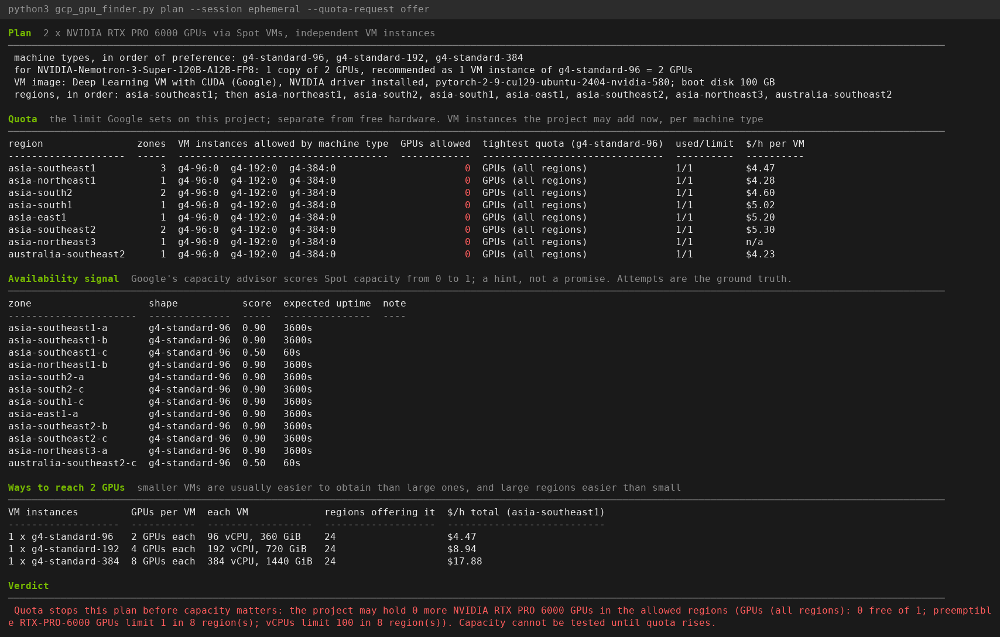

*`plan` for 2 x NVIDIA RTX PRO 6000 as Spot VMs, Singapore first and the rest of Asia-Pacific as fallback: quota per region and machine type, Google's capacity advisor score per zone, the ways to reach the goal with prices, and the verdict. Here quota, not hardware, is what blocks the plan.*

### Requests Quota Increases Correctly, Once

- Opt-in (`--quota-request offer` or `file`). Nothing is filed until quota is confirmed to be the limit for your plan and you typed `yes` on a screen that shows each request in full.
- Requests only what the plan still needs: current usage plus the shortfall, in one region (or split across regions with `--quota-split`), never a round number plucked from the air.
- Files each quota once, never re-files or escalates, checks eligibility first (billing, usage history, whether Google takes requests for that quota), lists requests already on file from any tool, and then polls the status of what it filed during the run and in `status`.
- Carries your contact email, use case and justification exactly as you typed them.

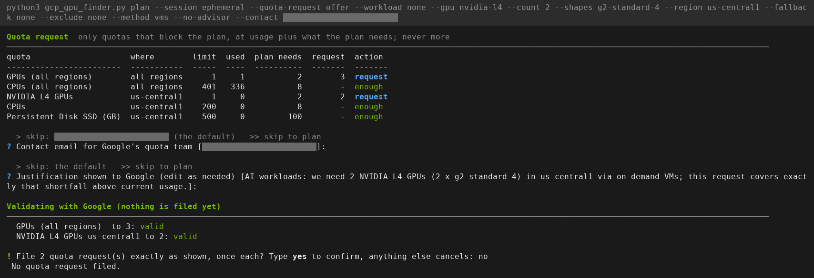

*2 x NVIDIA L4 as on-demand VMs in us-central1: the two quotas that block the plan, each requested at usage plus the shortfall, validated by Google without filing, then the typed confirmation. It was answered `no` for this screenshot, so nothing was filed.*

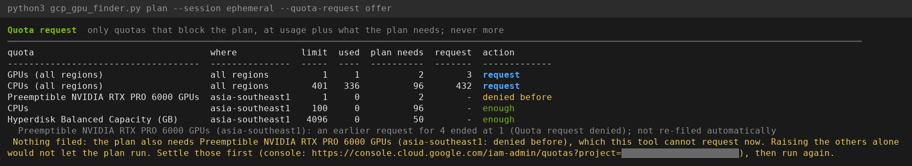

*When one of the quotas a plan needs was denied before, the tool files none of them: raising the others alone would not let the plan run.*

### Sizes GPUs The Way NVIDIA And Google Deploy Them

Nothing about GPUs, machines, models or products is built into the file: every table is read live from Google's and NVIDIA's own pages and APIs, so a new release appears and a withdrawn one disappears. Each sizing row says what it is sized by.

- **On a Vertex AI endpoint:** NVIDIA's models in Model Garden, read live from the Agent Platform API with every machine type, GPU count and serving setting Google tested (tensor, pipeline, data and expert parallelism, context length, concurrency). Only those machine types are offered, one copy of the model per replica VM, never packed onto a larger VM, plus the spare VMs Google asks a reservation for Vertex AI to hold. The reservation is created shared with Google services (`serviceShareType` `ALLOW_ALL`), which Vertex AI needs, and the project's Vertex AI serving quota is shown beside its Compute Engine quota.
- **As an NVIDIA NIM on GKE or a VM:** NVIDIA's NIM list from the NGC catalog and each NIM's profiles from NVIDIA's NIM Metadata API: GPU, GPU count, precision, memory floor, and the GPUs NVIDIA validated each profile on. A profile NVIDIA validated on that GPU is recommended first; a row that only meets the memory floor says so. Where a NIM's metadata names no GPU, NVIDIA's NIM support matrix is read instead. Without network access to NVIDIA or without an NGC key, a dated snapshot of both built into the file is used.
- **Your traffic:** the longest request (prompt plus answer, in tokens) and the peak requests in flight at once. The tool reads the model's published architecture and weights and estimates the requests one copy holds on each machine type, capped by the serving setting, then recommends model copies, VM instances and GPUs in total, fewest GPUs first.

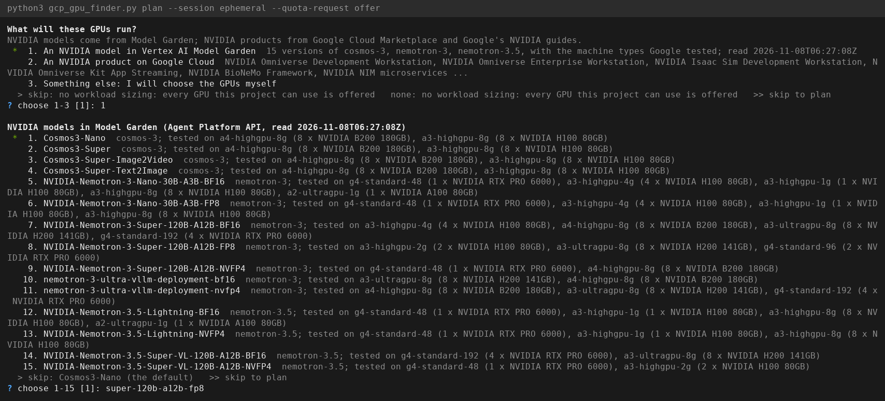

*NVIDIA's models read live from Model Garden, each with the machine types Google tested it on.*

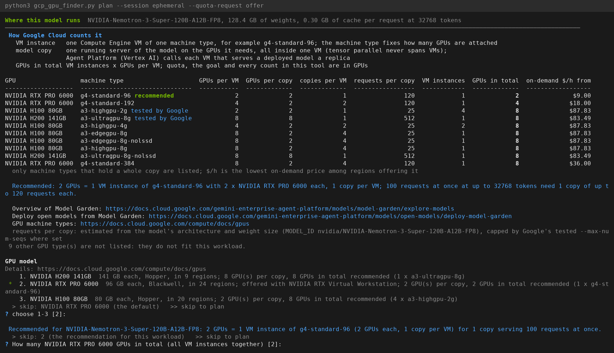

*Recorded with version 1.6.1, which also listed larger machine types holding several copies. From 1.7.0 a Vertex AI endpoint is sized only on the machine types Google tested, one copy per replica: for this model and traffic, 2 x g4-standard-96 (one replica and the spare VM Google asks for).*

### Sizes NVIDIA Blueprints, Samples And Products

- **Blueprints and samples:** NVIDIA's blueprints from the NGC catalog, each linked to its GitHub repository through NVIDIA's blueprint page, and samples from NVIDIA's and Google's repositories (`GPUF_CATALOG_SOURCES`), with their Google Cloud deployment paths, the GPUs their manifests request and the NIMs they run. A blueprint is sized by its NIMs and GPU requests; a part NVIDIA publishes no sizing for is named, never guessed.
- **Products:** Isaac Sim, Omniverse Kit and the others in `GPUF_PRODUCT_PAGES` are sized by NVIDIA's own requirement pages: RAM, cores, GPU memory, driver, and NVIDIA's GPU rules (architectures its RTX renderer does not support; GPUs without RT cores where the product says so). A machine type NVIDIA's Google Cloud page names but that falls short of NVIDIA's own minimum is reported, not recommended.
- **Marketplace images:** NVIDIA's Marketplace VM images read live from NVIDIA's image project, newest current image per product, with its operating system, CPU architecture, minimum disk and whether Google charges a license fee.
- `catalog` lists all of it, read live, without creating anything.

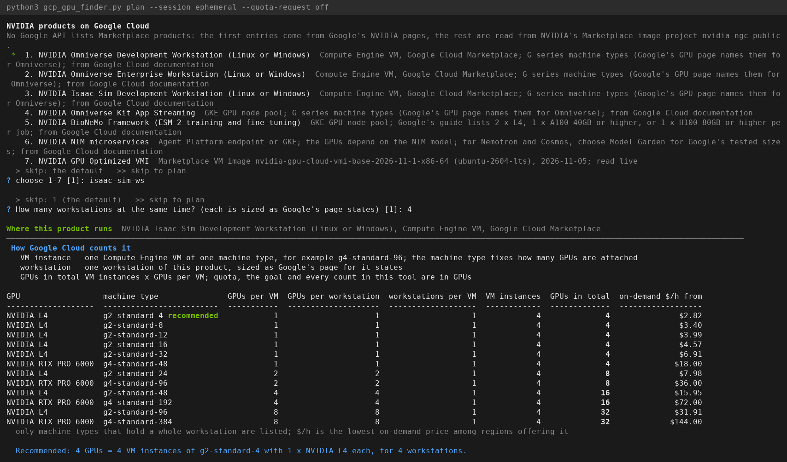

*Recorded with version 1.6.1, which sized products by Google's GPU rule and recommended g2-standard-4. From 1.7.0 products are sized by NVIDIA's requirement page: g2-standard-4 falls short of Isaac Sim's minimum of 32 GB RAM and 4 cores, and n1-standard-8 with one T4 is recommended.*

### Recommends From What Is Available And What You Need

- The GPU model, machine types and GPU total default to the sizing recommendation; the machine types are listed in order of how easy they are to obtain, and the regions that actually offer them are grouped by geography.
- Preferred regions are tried in your order. Fallback regions are ranked by Google's capacity advisor score, then by price, so the loop goes where hardware is most likely to be free and cheapest first.
- Prices are shown per method (on-demand, Spot, flex-start, calendar) for every region and machine type, and an optional hourly spending cap for everything held keeps the loop from buying past your budget.
- The `doctor` command checks sign-in, project, billing, enabled APIs, the IAM permissions each method needs, organization policies, networks and usable regions, and suggests the smallest predefined role that fixes anything missing. Menus grey out what your account cannot do rather than failing later.

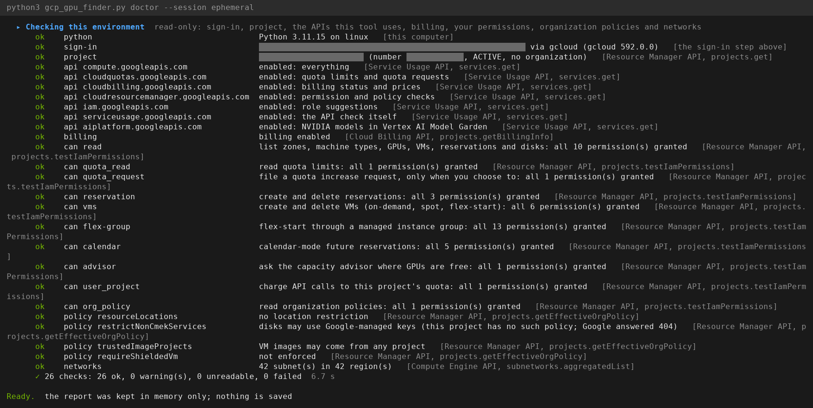

*`doctor`: 26 read-only checks of sign-in, project, APIs, billing, the permissions each method needs, organization policies and networks, each naming the Google API it asked.*

### Searches As Narrowly Or As Broadly As You Want

- Narrow: one region, one machine type, one method, one zone at a time; or a cluster layout that only accepts whole groups of VMs in a single zone.
- Broad: regions by name, by Google's geography (`apac`, `europe`, `north-america`) or by prefix (`asia`), a fallback list, an exclusion list, several machine types in preference order, and `all` at any question to open it up to every region or every machine type that offers your GPU.
- Six ways to hold capacity, chosen per run: on-demand reservation, on-demand VMs, Spot VMs, flex-start VMs and flex-start groups (Dynamic Workload Scheduler), and calendar-mode future reservations. Which machine series offer each method is read from Google's consumption-option table.
- Every question accepts a flag, so the same search can be scripted; `--dry-run` runs one full pass of the search without a single write.

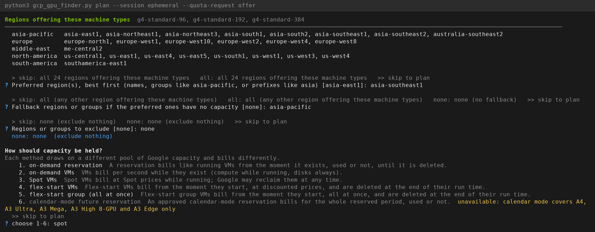

*The regions that offer the chosen machine types, grouped by geography; one preferred region, a whole group as fallback, and the six ways to hold capacity with how each one bills.*

### Runs Until The Entire Request Is Met

- Loops for days or weeks, one attempt at a time so a large ladder of regions, zones and sizes is swept every few minutes without hammering your project's rate limits (it reads your real per-region limits and uses a fraction of them).
- Takes capacity as it appears: each attempt asks for exactly what is still missing, sized to the remaining GPUs, the quota headroom in that region and the spending cap, never more than the goal unless you allow overshoot. Held GPUs accumulate across zones, machine types and attempts until held equals goal.
- Options that are quota-bound are not retried uselessly: quota and usage are re-read during the run (`GPUF_QUOTA_REFRESH_S`), each quota-bound option gets a single verification attempt on a schedule (`GPUF_QUOTA_VERIFY_S`), filed quota requests are polled (`GPUF_QUOTA_POLL_S`), and when quota rises those options come back into the sweep.
- The live dashboard shows which machine type, zone and method is being tried, the Google call and operation in flight, what comes next and how far the sweep has got; `--plain` gives the same as a line log for `nohup`, `screen` or `tmux`.
- Stop with Ctrl-C at any time: new attempts stop, queued flex-start requests are cancelled so nothing appears later unseen, a summary prints, and you choose to keep or release what was obtained. `resume RUN_ID` picks a stopped run back up; `--maintain` keeps running after the goal and replaces anything Google reclaims.

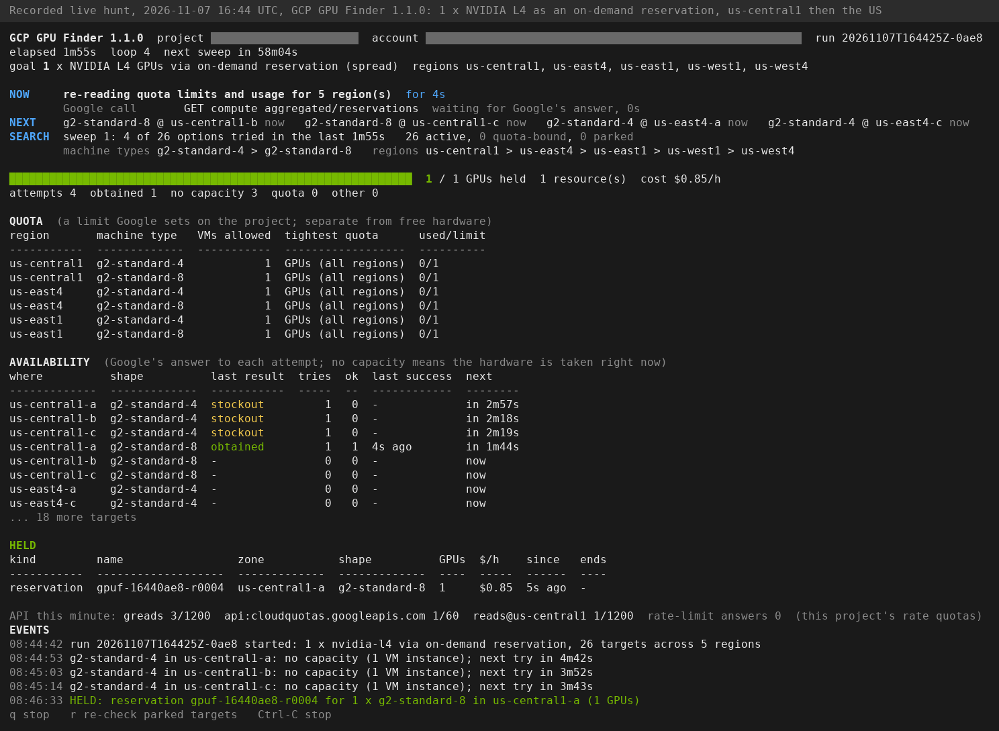

*A real hold, recorded on 2026-11-07 with version 1.1.0: g2-standard-4 was out of stock in three zones, the next option, g2-standard-8 in us-central1-a, was obtained, and the goal of 1 GPU was met in 1m55s. The reservation was released afterwards.*

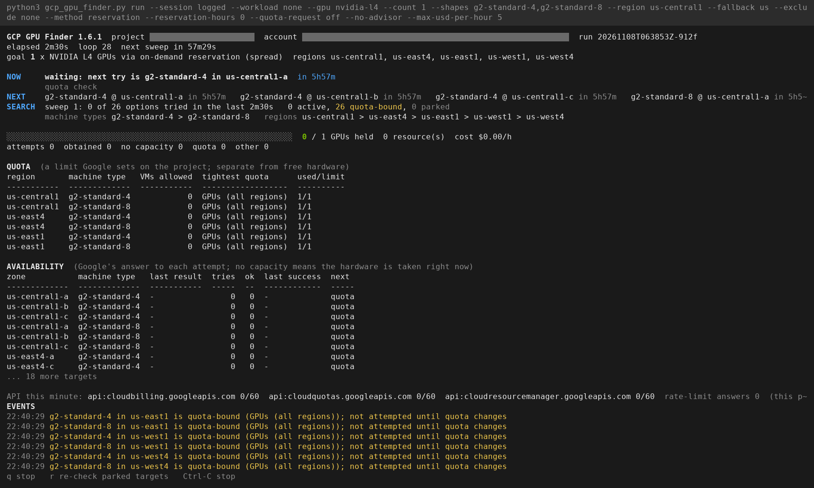

*Version 1.6.1 hunting 1 x NVIDIA L4 as an on-demand reservation in us-central1 and the US while the project's only GPU of quota was in use: all 26 options are quota-bound, none is attempted, and the loop keeps running until quota changes instead of giving up. Stopped with Ctrl-C for this screenshot; it held nothing.*

## Requirements

- Python 3.9 or newer. No third-party packages.
- A Google Cloud account with a project, or a project to create one in. If `gcloud` is missing, `setup` offers to install Google's official archive for your OS and CPU, without administrator rights.
- Permissions are listed in the file header under PERMISSIONS and checked for you by `doctor`; `roles/compute.viewer` is enough to plan.

## Quick Start

```
python3 gcp_gpu_finder.py setup      # install gcloud if needed, sign in, pick the project, enable APIs
python3 gcp_gpu_finder.py plan       # quota, availability and options for what you want; creates nothing
python3 gcp_gpu_finder.py            # the wizard asks everything, then holds the capacity
```

Every question has a default, a skip (`>`), a skip-all (`>>`), a back (`<`) and a flag, so the same run can be scripted. Ctrl-C stops new attempts, prints a summary and asks whether to keep or release what was obtained.

Some first reads take time: Google's price list is tens of thousands of entries, and the NVIDIA catalog reads NGC, every blueprint page and dozens of GitHub repositories. Each read is named on screen before it is made, a step that reads many things reports each one as it finishes, and a step that has printed nothing for `GPUF_PROGRESS_S` seconds (default 5) says what it is still reading, for how long, and how far through a long list it is. A source that cannot be read is reported the moment it fails. Later runs reuse the cached reads and are quick.

A sized, scripted example: size an NVIDIA model as a NIM on GKE at a given context length and peak concurrency, search a preferred region with the rest of its geography as fallback, hold the capacity as Spot VMs, and let the tool offer a quota request if quota turns out to be the limit.

```
python3 gcp_gpu_finder.py --workload model --target nim --model super-120b-a12b-fp8 --context 8192 --peak 32 \
    --region asia-southeast1 --fallback apac --method spot --quota-request offer --session logged
```

For a Vertex AI endpoint use `--target vertex` with `--method reservation` or `--method calendar`; for a blueprint or sample, `--workload catalog --item rag`; for a product, `--workload product --product isaac`.

## Commands

- `plan` analysis only: quota, availability, prices and the options that fit.
- `setup` install gcloud, sign in, choose the project, enable the APIs, create a network if the project has none; each step asks first.
- `doctor` environment and permission report, with the exact command or link that fixes each finding.
- `run --config F` replay a saved run's answers; add `--yes --session logged` for an unattended run.
- `status RUN_ID`, `resume RUN_ID`, `release RUN_ID` what a run holds, continue a stopped run, delete only what that run created.
- `catalog` NVIDIA on Google Cloud, read live: Model Garden models, NIMs, products, blueprints, samples and Marketplace images.
- `log [RUN_ID|PATH]` read an audit log back; `knobs` every tunable setting and its default; `self-test` offline checks of this file.

`--help` on any command lists its flags. The file header is the full manual.

## How It Holds Capacity

You choose one method per run. All of them create real, billed resources in your project.

- `reservation` on-demand reservation, capacity held in your name with no VMs running yet.
- `vms` standard on-demand VMs created in bulk.
- `spot` Spot VMs, much cheaper, reclaimable by Google at any time.
- `flex` and `flex-group` flex-start (Dynamic Workload Scheduler) VMs, queued per request, discounted, deleted after their run time.
- `calendar` calendar-mode future reservation, no quota needed, billed for the whole period.

Which machine series offer each method comes from Google's consumption-option table. For a Vertex AI endpoint only `reservation` (shared with Google services, as Vertex AI requires) and `calendar` apply.

## What It Never Does

- Install software, sign in, enable an API or create a network without asking first (`--install-missing` is the only way to pre-approve those).
- Link billing, change IAM, edit organization policies, or touch a resource it did not create. Everything a run creates carries the label `gpu-finder-run=<run id>` or a name starting with `gpuf-<run>`, and `release` deletes only those.
- File a quota increase unless you opted in, quota is confirmed to be the limit, and you typed `yes` on a screen showing the exact request. It files each quota once and never re-files or escalates.
- Store, print or log an access token, a key or a password.

## Credentials

The tool never handles long-lived credentials itself. It holds short-lived access tokens in memory and nothing else.

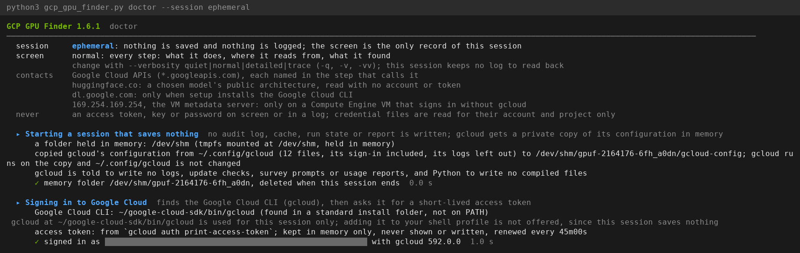

*Every run opens by stating what it contacts and what it never does, then shows where its access token comes from: `gcloud auth print-access-token`, kept in memory only.*

- Tokens come from `gcloud auth print-access-token` (optionally with `--impersonate-service-account`), from the Compute Engine metadata server, or from `GPUF_ACCESS_TOKEN` when you supply one. They are refreshed on a schedule and never written to disk, the audit log or the screen. If the token command fails, only its error text is reported, never its output.
- A key file (`--key-file`) is handed to `gcloud auth login --cred-file` and read by the tool only for its type, account and project. When another account is already active, the sign-in goes into a separate gcloud configuration (`GPUF_SETUP_GCLOUD_CONFIG`, default `gpu-finder`) so your own setup is untouched.
- gcloud's own token cache lives where gcloud keeps it; in an ephemeral session it lives in a tmpfs copy that is deleted when the session ends.
- An NGC key is optional. With one, the tool reads a NIM's NGC record (to find NVIDIA's support matrix for NIMs whose metadata names no GPU) and its model card (NVIDIA's stated minimum GPUs). It is taken from `GPUF_NGC_API_KEY` or `NGC_API_KEY`, else from the `nvcr.io` login enroot keeps for container pulls, else a hidden prompt, and is held in memory only: never shown, logged, cached or written. Without one, a dated snapshot of NVIDIA's NIM profiles and support matrices built into the file stands in, and the screen says so.
- A GitHub token is optional: `GPUF_GITHUB_TOKEN` (or `GITHUB_TOKEN`) raises GitHub's limit of 60 unauthenticated calls an hour for reading blueprint and sample repositories; repository reads are cached for a day and revalidated by ETag.
- Network calls go to `*.googleapis.com`, `docs.cloud.google.com` (Google's published tables), `huggingface.co` (a chosen model's public architecture file, no token), `api.ngc.nvidia.com`, `docs.nvidia.com` and NVIDIA's product documentation sites, `build.nvidia.com`, `api.github.com` and `raw.githubusercontent.com`, the metadata server on GCE, and `dl.google.com` only when setup installs gcloud. `HTTPS_PROXY`, `NO_PROXY`, `--ca-bundle` and `GPUF_CA_BUNDLE` are honored. The gcloud download is verified over TLS; set `GPUF_GCLOUD_SHA256` to the checksum Google publishes to pin it.

## Sessions And Files

Before anything is read or written the tool asks whether the session is `logged` or `ephemeral` (`--session`, or `GPUF_SESSION`).

- `logged` writes under `GPUF_HOME` (default `~/.gcp_gpu_finder`): `setup.json`, `logs/<command>-<time>-<pid>.jsonl`, `runs/<run id>/{state.json,config.json,events.jsonl,summary.txt}` and `cache/`. Runs can be resumed, released and read back by id.
- `ephemeral` writes nothing to this computer. Run state, answers and caches stay in memory; gcloud runs on a private copy of its configuration in a tmpfs folder (`/dev/shm`, `$XDG_RUNTIME_DIR` or `GPUF_EPHEMERAL_DIR`) that is deleted at exit, including after Ctrl-C or SIGTERM. Capacity obtained is still real and is found later by its label. Swap without encryption can still leave traces of RAM on disk; that is outside the tool's control.

Audit logs, run state and `setup.json` are created readable by your user only, in folders created the same way. The log records the signed-in account and project, your user name, working folder and command line, every answer, and at trace level the full body of each write request (for a quota request that includes the contact email and justification you gave). Treat a log as yours before sharing it.

## Configuration

Every limit, interval, path, color and threshold is an environment variable with a documented default; `python3 gcp_gpu_finder.py knobs` prints all of them with their meaning. Nothing needs editing in the source. Flags override saved answers, which override knob defaults.

## Unattended Runs

```
python3 gcp_gpu_finder.py run --config ~/.gcp_gpu_finder/runs/<run id>/config.json --yes --session logged
```

Add `--install-missing` and `--key-file` to let a scripted run install gcloud and sign in. For runs of days, sign in with a service account (`--impersonate-service-account`), run under `nohup`, `screen` or `tmux`, and use `--plain` for a line log. Exit codes: 0 goal reached or plan finished, 1 error before the run, 2 stopped before the goal, 3 blocked for a named reason, 130 cancelled at a question.

## Verifying The File

```
python3 -m py_compile gcp_gpu_finder.py
python3 gcp_gpu_finder.py self-test
```

The self-test runs offline and covers the parser, the request planner, the quota verdict, the Model Garden sizing, the readers of NVIDIA's NIM support matrices, blueprint pages, sample trees and GPU rules, the Vertex AI reservation body, the progress lines, the audit trail and its file permissions, the token error path, archive extraction safety and the setup helpers. `ruff check gcp_gpu_finder.py` passes with no findings.

The built-in NIM snapshot carries the date it was read, and the screen shows that date whenever the snapshot is used; the maintainer refreshes it from NVIDIA's live sources at each release.

## Changes In 1.7.0

- **Sized by deployment target:** `--target vertex` sizes a Vertex AI endpoint only on the machine types Google tested for the model, one copy per replica VM plus the spare VMs Google asks for; `--target nim` sizes an NVIDIA NIM by NVIDIA's profiles, the ones NVIDIA validated on that GPU first. Earlier versions also listed larger machine types holding several copies, which Vertex AI does not deploy.
- **Vertex AI holds:** reservations for a Vertex AI endpoint are shared with Google services (`ALLOW_ALL`), only reservation and calendar mode are offered for it, and Vertex AI serving quota is shown beside Compute Engine quota.
- **NVIDIA catalog:** the new `catalog` command and wizard choice list Model Garden models, NIMs, NVIDIA blueprints with their GitHub repositories, Google Cloud samples, products and Marketplace images, all read live.
- **Products:** Isaac Sim, Omniverse Kit and the others are sized by NVIDIA's requirement pages and GPU rules instead of a built-in list.
- **Nothing built in:** GPU memory and architecture, machine series, holding methods, boot disks, disk quotas, price words, geographies, location groups and documentation addresses are read from Google's and NVIDIA's pages; a dated NIM snapshot stands in only when NVIDIA cannot be reached or no NGC key is available.
- **Visible progress:** every read is named before it is made, long steps report each item and say what they are still reading when they have been quiet for `GPUF_PROGRESS_S` seconds, and a source that cannot be read is reported when it fails.
- **Region groups:** fallback and exclusion groups use Google's geography names (`apac`, `europe`, `north-america`); `asia-pacific` is no longer a group name.

## Reporting A Problem

Open an issue with the command you ran, the verdict line and the relevant lines of the audit log (`log --last N`), after reading them for anything you would not share. Tokens never appear in a log; account names, project ids and your answers do.

## License

Apache License, Version 2.0; the full text is in `LICENSE`. Use, change and redistribute it freely, keep the `LICENSE` and `NOTICE` files and the copyright line in the script header with any copy, and mark the files you change. `NOTICE` carries the attribution that section 4(d) of the license requires derivative works to keep.
